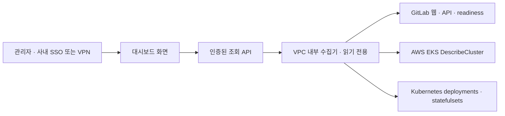

# 실제 데이터 연동 준비 — EKS / GitLab Self-Managed HA

## 이번에 준비한 범위

개요 최상단의 **현재 인프라 상태** 패널과 읽기 전용 수집기를 추가했습니다. 아직 실제 주소·토큰·AWS 역할을 설정하지 않았으므로 공개 사이트는 **미연동**으로 표시합니다. 정상 상태를 추정하거나 예시 정상 값으로 대체하지 않습니다.

수집 대상은 GitLab 로그인 페이지 응답, 토큰을 통한 버전 API 응답, 종속 서비스가 포함된 readiness, EKS 제어 영역, GitLab의 Deployment/StatefulSet 목표·준비 복제본입니다. Webservice 5대/Gitaly 3대 같은 숫자를 고정하지 않습니다. `spec.replicas`와 `status.readyReplicas`/`availableReplicas`, 컨트롤러 세대 및 StatefulSet 리비전을 비교합니다. 원하는 구성 요소를 찾지 못하면 확인 불가로 처리합니다.

전체 대시보드의 실제 데이터 전환은 아직 완료하지 않았습니다. 파이프라인·사용자·비용·구성도·인시던트·AI 등은 기존 데모를 유지합니다. 이 수집기는 EKS 노드·AZ 분산, PVC/EBS 상태·디스크 사용률, ALB 타깃, RDS/ElastiCache, Sidekiq 큐, Prometheus 지표, Gitaly/Praefect 복제 지연을 아직 검사하지 않습니다. 준비 복제본이 충분한 것만으로 HA 전체가 검증되는 것은 아닙니다.

## 권장 구조



GitHub Pages는 정적 파일 호스팅입니다. GitLab 토큰이나 AWS 인증 정보를 보관하고 호출하는 서버가 아닙니다. 프런트엔드에는 비밀이 아닌 조회 API URL만 들어갑니다. 운영 데이터는 SSO/VPN으로 제한된 API 또는 사내 호스팅 화면에서 조회하세요. CORS만으로 인증을 대신하지 않습니다. 공개 Pages에 실제 사용자 목록·내부 호스트·구성·비용 JSON을 저장하지 마세요.

현재 포함된 HTTP 서버는 **127.0.0.1 전용 로컬 개발 서버**입니다. 공개 주소나 `0.0.0.0`으로 열지 않습니다. 운영 배포에는 인증 게이트웨이, 접근 정책, HTTPS, 수집기 실행 역할, 비밀 저장소, 네트워크 경로를 먼저 구성해야 합니다. 이 단계는 아직 배포하지 않았습니다.

## 내일 준비할 정보

| 준비할 것        | 내용                                                                                                         |
| ---------------- | ------------------------------------------------------------------------------------------------------------ |
| GitLab 주소·버전 | HTTPS 주소, GitLab 버전, Helm/Operator 배포 방식, 사설 CA 유무, SSO 리다이렉트 유무                          |
| 점검 네트워크    | 수집기가 GitLab과 EKS API에 접속할 VPC/VPN 경로, readiness 점검 IP 허용 목록                                 |
| GitLab 토큰      | 가능하면 전용 조회 계정의 `read_api` 토큰, 만료일. `api`·`sudo`·쓰기 권한은 이번 상태 조회에 필요하지 않음   |
| AWS              | 계정, 리전, EKS 클러스터 이름, 수집 전용 IAM 역할 또는 로컬 SSO 프로필                                       |
| Kubernetes       | 명시적 kube context, GitLab 네임스페이스 목록, Webservice/Gitaly의 실제 이름과 라벨                          |
| 조회 RBAC        | 해당 네임스페이스의 `deployments`·`statefulsets` `get/list`. IAM EKS 조회 권한과 Kubernetes 접근 권한은 별개 |
| 공개 범위        | 사내 SSO/VPN 제한 또는 별도로 승인한 공개 요약. 인증 없는 운영 API를 공개하지 않음                           |
| 확장 수집        | 설치된 Prometheus/Grafana·metrics-server 유무, 스토리지/Praefect/ALB 감시 항목과 임계값                      |

토큰·비밀키를 채팅에 붙이지 마세요. 로컬의 git에서 제외된 환경 파일 또는 운영 Secret Manager에 저장하세요. AWS는 SSO/역할 기반 임시 자격 증명을 우선합니다. 관리자의 기존 쓰기 권한을 그대로 수집기에 넣을 필요가 없습니다. 관리자 전용 목록 API를 나중에 추가할 때에만 해당 GitLab 버전의 Admin Mode 요구와 최소 권한을 따로 검토합니다.

## 로컬에서 시작하기

필수: Node.js 24 이상, AWS CLI v2, `kubectl`, 사내 VPN/네트워크 접근. AWS CLI와 kubectl은 프로젝트가 설치하거나 인증을 변경하지 않습니다.

1. `.env.example`을 `.env.collector.local`로 복사하고 서버 설정만 입력합니다. `GITLAB_BASE_URL`과 `GITLAB_READ_TOKEN`은 별도 항목입니다. 토큰을 URL에 넣지 않습니다.
2. 준비한 SSO 프로필로 `aws sso login --profile YOUR_PROFILE`을 실행합니다. 지정 클러스터의 kube context를 준비하고, 해당 IAM 역할을 EKS access entry와 조회 전용 RBAC에 연결합니다. 이 작업은 실제 환경에 맞춰 관리자가 수행해야 합니다.
3. `KUBE_NAMESPACES=gitlab,gitlab-gitaly`처럼 실제 네임스페이스를 입력합니다. `KUBE_COMPONENTS=webservice,gitaly`는 Helm의 `app`/`app.kubernetes.io/name` 라벨 또는 워크로드 이름에 맞춥니다. 누락된 구성 요소는 정상 판정을 막습니다.
4. `npm run infra:collect`를 실행합니다. 결과는 git에서 제외된 `.local/infra-status.json`에만 저장됩니다. 설정이 비어 있으면 외부 호출 없이 확인 불가 결과가 나옵니다.
5. 터미널 하나에서 `npm run infra:serve`를 실행합니다. `http://127.0.0.1:4318/api/infra/status`가 로컬 조회 API입니다. GET/OPTIONS만 허용하며, 15초 캐시와 동시 수집 중복 방지가 있습니다.
6. 프런트엔드용 `.env.local`에 아래 **비밀이 아닌 주소만** 넣고 `npm run dev`를 다시 실행합니다.

```dotenv
NEXT_PUBLIC_INFRA_STATUS_URL=http://127.0.0.1:4318/api/infra/status
```

7. `http://localhost:3000/infradash-codex7/`에서 확인합니다. 로컬 API는 localhost/127.0.0.1:3000의 Origin만 허용합니다. HTTPS 공개 Pages에서 이 로컬 HTTP API로 연결하는 방식은 사용하지 않습니다.

환경 파일에 없는 값을 수집기가 추측하지 않습니다. kube context의 서버 주소가 AWS가 반환한 EKS endpoint와 다르면 Kubernetes 조회를 중단합니다. GitLab 요청은 GET만 사용하며, API 토큰은 버전 API의 헤더에만 전달합니다. 외부 리다이렉트를 따라가며 토큰을 전달하지 않습니다. 원본 응답·오류·토큰·호스트명은 프런트엔드에 반환하지 않습니다.

## 권한 템플릿

- [IAM 정책 템플릿](iam-collector-policy.json): REGION/ACCOUNT_ID/CLUSTER_NAME을 바꿉니다. 현재 필요한 AWS 동작은 `eks:DescribeCluster`뿐입니다.
- [Kubernetes Role / RoleBinding](kubernetes-reader.yaml): 네임스페이스와 EKS access entry의 그룹 매핑을 실제 환경에 맞춰 검토합니다. Secret·Pod exec·삭제·재시작 권한은 포함하지 않습니다.

템플릿을 자동 적용하지 않습니다. 운영 토폴로지와 접근 방식이 확정되면 필요한 부분만 적용하세요. CloudWatch·스토리지·비용 수집을 추가하면 각 조회 API에 맞는 권한을 별도로 추가합니다.

## 데이터 신뢰성과 운영 전환

- 브라우저는 30초마다 갱신합니다. HTTP 오류, SSO 401/403, 타임아웃, 스키마 오류는 확인 불가로 표시합니다. 이전 정상 결과가 있더라도 정상 색으로 유지하지 않습니다.
- 2분 이상 오래된 결과, 미래 시간, 체크별 수집 시각 누락은 최신 결과로 표시하지 않습니다. 마지막 수집 시각은 KST로 표시합니다.
- `GET /-/health`의 성공만으로 DB/Gitaly 정상을 판단하지 않습니다. `/-/readiness?all=1`과 각 HA 워크로드를 구분합니다. 대규모 EKS에서 readiness는 일부 Pod의 관측이며, 실제 사용자 가용성과 완전히 같지 않습니다.
- 운영 API는 반드시 인증된 프록시 뒤에 배치하고, 세션 쿠키·정확한 Origin CORS·캐시 금지·타임아웃을 설정합니다. `services/collector/collect.ts`는 수집 로직으로 재사용할 수 있지만 로컬 서버를 그대로 공개하는 배포는 준비 범위 밖입니다.
- 실제 데이터 전환 순서: 현재 상태 → 러너/파이프라인(조회 범위·페이지네이션·캐시) → 사용자/권한(개인정보 접근 제어) → Prometheus/스토리지/비용. 쓰기 작업은 별도의 승인·감사 흐름을 설계한 후 추가합니다.
- `.local/`, `.env*.local`, kubeconfig, 실제 상태 JSON을 `public/`·`out/`·공개 Actions artifact에 넣지 않습니다. 공개 Pages의 빌드에는 collector 환경 파일이나 자격 증명을 주입하지 않습니다.

## 공식 자료

- [GitLab health/readiness와 점검 IP 허용 목록](https://docs.gitlab.com/administration/monitoring/health_check/)
- [GitLab 토큰 범위: read_api와 api의 차이](https://docs.gitlab.com/security/tokens/access_token_scopes/)
- [AWS SDK의 Node.js 자격 증명 체인](https://docs.aws.amazon.com/sdk-for-javascript/v3/developer-guide/setting-credentials-node.html)
- [EKS 클러스터 접근 권한](https://docs.aws.amazon.com/eks/latest/userguide/access-entries.html)
- [Kubernetes RBAC](https://kubernetes.io/docs/reference/access-authn-authz/rbac/)
